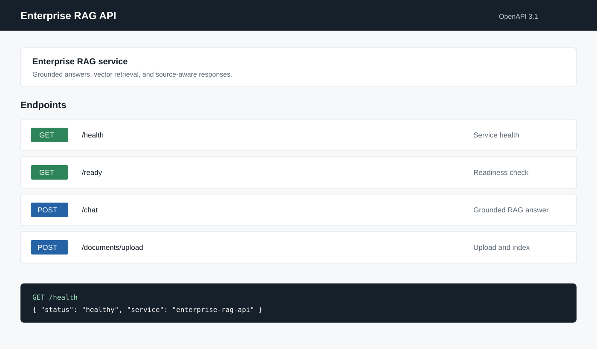
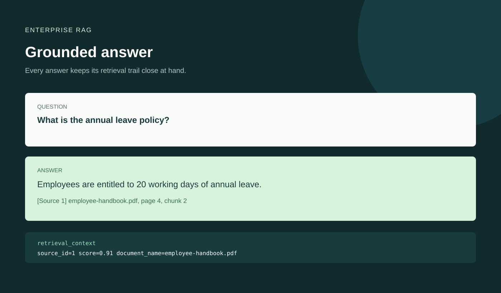
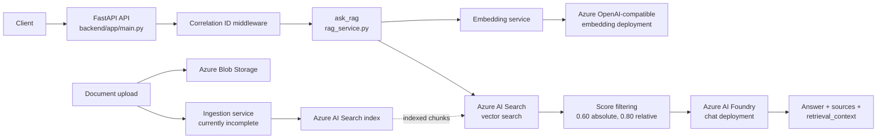

# Enterprise RAG


**Enterprise RAG** is an Azure-native Retrieval-Augmented Generation service built with FastAPI. It embeds questions, retrieves relevant document chunks from Azure AI Search, and asks an Azure AI Foundry/OpenAI-compatible deployment for a concise, source-aware answer.

> This is an engineering prototype with a working retrieval and answer-generation path. Ingestion, authentication, persistence, and production operations remain explicit work items.

## At A Glance

| Layer | Implementation |
| --- | --- |
| API | FastAPI with health, readiness, chat, and upload routes |
| Retrieval | Azure AI Search vector search with score filtering |
| Generation | Azure AI Foundry chat deployment |
| Embeddings | OpenAI-compatible Azure endpoint |
| Evaluation | DeepEval with a custom Azure model adapter |

## Screenshots

The repository includes representative captures of the documented API experience and source-aware response contract:

<p align="center">
  
</p>

<p align="center">
  
</p>

These are static project captures, not live service output. Actual answers depend on the configured Azure resources and indexed documents.

The repository is an engineering prototype with a working retrieval and answer-generation path, plus evaluation and ingestion components at different stages of completion. The status notes below are intentional: they describe the code that exists today rather than implying production readiness.

## Key Features

- FastAPI service with `/health`, `/ready`, `/chat`, and `/documents/upload` routes.
- Azure AI Search vector retrieval over the `content_vector` field.
- Query embeddings generated through an OpenAI-compatible Azure endpoint.
- Azure AI Foundry `AIProjectClient` for grounded chat completions.
- Absolute and relative relevance filtering before answer generation.
- Source metadata, page/chunk identifiers, scores, and 500-character snippets in responses.
- Correlation ID middleware for request tracing.
- Sentence-aware text chunking with overlap and duplicate removal.
- DeepEval evaluation using Azure AI Foundry as the evaluator model.
- Search index creation and focused Azure service test scripts.

## Architecture



### Request flow

1. `POST /chat` accepts a JSON body containing `question`.
2. `ask_rag()` trims and validates the question.
3. `generate_embedding()` creates a query vector.
4. `vector_search()` performs vector-only retrieval in Azure AI Search.
5. Low-confidence results are rejected; accepted chunks become numbered `[Source N]` context blocks.
6. Azure AI Foundry generates an answer using only that context.
7. The API returns the answer, citation metadata, and retrieved text context.

## RAG Pipeline

```text
Question
  -> validation and whitespace trimming
  -> embedding generation
  -> Azure AI Search vector query
  -> deduplication and score thresholds
  -> numbered document context
  -> Azure AI Foundry chat completion
  -> answer with source metadata
```

The system prompt instructs the model to use only the supplied context, avoid unsupported claims, cite supporting material as `[Source N]`, and return a fixed not-found response when the context does not contain an answer. If retrieval returns no accepted documents, the model is not called.

## Technology Stack

- Python 3.11-compatible Docker base image
- FastAPI and Uvicorn
- Pydantic Settings
- Azure AI Search SDK
- Azure AI Foundry `azure-ai-projects` SDK
- Azure Identity (`AzureCliCredential` and `DefaultAzureCredential`)
- OpenAI Python client for the Azure-compatible embedding endpoint
- Azure Blob Storage SDK
- `pypdf` for the standalone PDF loader
- DeepEval and the custom `AzureDeepEvalModel` adapter
- SQLAlchemy, psycopg, and Alembic are installed dependencies, but PostgreSQL is not currently used by application code

## Project Structure

```text
.
├── backend/
│   ├── app/
│   │   ├── main.py                         # FastAPI application and routes
│   │   ├── core/                            # Settings, logging, middleware
│   │   └── services/                        # RAG, search, embeddings, storage
│   ├── ingestion/
│   │   ├── chunking/text_chunker.py        # Standalone character chunker
│   │   ├── loaders/pdf_loader.py           # Standalone PDF page loader
│   │   └── pipeline.py                     # Placeholder pipeline entrypoint
│   ├── scripts/                             # Index, upload, search, and service checks
│   ├── requirements.txt
│   └── Dockerfile
├── evaluation/
│   ├── test_rag_evaluation.py               # DeepEval entrypoint
│   ├── azure_deepeval_model.py              # Foundry-backed evaluator model
│   └── datasets/rag_test_cases.json         # Five evaluation questions
├── tests/test_blob_upload_script.py         # Pytest coverage currently present
├── docs/                                    # Empty in the current repository
├── frontend/                                # Empty in the current repository
├── infra/                                   # Empty in the current repository
├── PROJECT_STRUCTURE.md                     # Older structure snapshot
└── workspace-tree.txt                       # Workspace tree snapshot
```

## Retrieval System

The live query path is implemented in `backend/app/services/search_query_service.py`:

- At most five results are requested by default (`MAX_RESULTS = 5`).
- The query uses `search_text=None`, so retrieval is vector-only rather than hybrid keyword/vector search.
- Vectors are read from `content_vector`.
- Results are deduplicated by `(document_name, page_number, chunk_number)` and sorted by score.
- No metadata, tenant, user, or OData filter is applied by the query path.
- No reranker is configured.

### Vector search and relevance filtering

Two gates control whether retrieved chunks reach generation:

1. The best result must have an Azure AI Search score of at least `0.60`.
2. Each returned result must be at least `0.80 * best_score` by default.

The function prints retrieval diagnostics including the query, requested `top_k`, pre-filter count, best score, absolute minimum, relative minimum, and final count. These are diagnostic logs, not persisted observability data.

The index definition in `search_service.py` uses a 1,536-dimensional vector field with an HNSW algorithm/profile. It also defines filterable `document_name`, `document_type`, `source`, and `page_number` fields, although the current retrieval code does not use those filters.

## Document Ingestion and Chunking

`backend/app/services/document_ingestion_service.py` contains the most complete chunking implementation:

- Default chunk size: 500 characters.
- Default overlap: 100 characters.
- Normalizes line endings and whitespace.
- Splits paragraphs, then long paragraphs into sentence units.
- Preserves sentence-aware overlap where possible.
- Falls back to word-based splitting for an oversized sentence.
- Removes empty and duplicate chunks.

There are also standalone helpers under `backend/ingestion/`: `text_chunker.py` uses 1,000-character chunks with 200-character overlap, and `pdf_loader.py` extracts text page by page with `pypdf`. `pipeline.py` is currently a `pass` placeholder.

The upload route accepts `.txt`, `.pdf`, and `.docx`, writes the bytes to Azure Blob Storage, and then calls `ingest_document()`. That function is imported but is not defined in the current `document_ingestion_service.py`. Consequently, the upload/indexing workflow is incomplete even though the route and supporting helpers exist. There is no implemented TXT or DOCX parser in the repository.

## API Usage

### `GET /health`

Returns a static service health response.

### `GET /ready`

Returns a static readiness response; it does not verify Azure dependencies.

### `POST /chat`

Request:

```json
{
  "question": "What is the annual leave policy?"
}
```

The response contains `answer`, `sources`, and `retrieval_context`. Each source includes `source_id`, `document_name`, `page_number`, `chunk_number`, `score`, and a 500-character `snippet`.

### `POST /documents/upload`

Accepts a multipart file upload for `.txt`, `.pdf`, or `.docx`. The endpoint currently uploads the file to Blob Storage before reaching the missing ingestion function, so it should be treated as incomplete.

## Configuration

Settings are loaded once by `backend/app/core/config.py` using Pydantic Settings. The configured environment file is `backend/.env`; environment names are case-insensitive and extra variables are ignored.

Create a local `backend/.env` from `backend/.env.example` and supply values through your own secret-management workflow. Do not commit the file or place credentials in this README.

| Variable | Purpose |
| --- | --- |
| `APP_NAME` | Application name |
| `ENVIRONMENT` | Runtime environment label |
| `API_VERSION` | API version setting |
| `AZURE_AI_PROJECT_ENDPOINT` | Azure AI Foundry project endpoint |
| `CHAT_DEPLOYMENT_NAME` | Chat deployment used for answers and evaluation |
| `EMBEDDING_DEPLOYMENT_NAME` | Embedding deployment name |
| `AZURE_SEARCH_ENDPOINT` | Azure AI Search endpoint |
| `AZURE_SEARCH_INDEX_NAME` | Search index name; defaults to `enterprise-documents` |
| `AZURE_SEARCH_API_KEY` | Azure AI Search key |
| `AZURE_STORAGE_ACCOUNT_URL` | Blob account URL used by the upload route |
| `AZURE_STORAGE_ACCOUNT_KEY` | Blob account key used by the upload route |
| `AZURE_BLOB_CONTAINER_NAME` | Blob container used by the upload route |
| `STORAGE_ACCOUNT_NAME` | Storage account name used by the separate credential-based Blob service |
| `STORAGE_CONTAINER_NAME` | Container used by the separate Blob service; defaults to `enterprise-rag-documents` |
| `POSTGRES_HOST` | Defined setting; currently unused |
| `POSTGRES_PORT` | Defined setting; defaults to `5432`; currently unused |
| `POSTGRES_DB` | Defined setting; defaults to `postgres`; currently unused |
| `POSTGRES_USER` | Defined setting; currently unused |
| `POSTGRES_PASSWORD` | Defined setting; currently unused |

The repository also contains additional values in the local `.env` that are not read by `Settings`, including `AZURE_EMBEDDING_URL`, `AZURE_EMBEDDING_KEY`, `AZURE_EMBEDDING_MODEL`, `AZURE_OPENAI_CHAT_ENDPOINT`, and `AZURE_OPENAI_CHAT_KEY`. They are not required by the documented application configuration path.

## Installation

From the repository root:

```powershell
python -m venv .venv
.\.venv\Scripts\Activate.ps1
python -m pip install -r backend\requirements.txt
az login
```

The checked-in requirements file includes `deepeval` alongside the application dependencies, so a clean install also provisions the evaluation tooling.

## Running the Backend

From the repository root, with `backend/.env` configured:

```powershell
python -m uvicorn backend.app.main:app --reload
```

The intended local URL is `http://127.0.0.1:8000`. The interactive API is available at `http://127.0.0.1:8000/docs`.

Current status: the chat path is available, but document upload is intentionally disabled with HTTP 501 until the ingestion workflow is implemented. The Dockerfile runs from the repository-root package layout so imports remain consistent with local development.

To create the Azure AI Search index, the repository provides:

```powershell
python backend\scripts\create_search_index.py
```

## Evaluation

The evaluation entrypoint is:

```powershell
python -m evaluation.test_rag_evaluation
```

It loads `evaluation/datasets/rag_test_cases.json`, calls the live `ask_rag()` flow for each case, and evaluates the resulting answer and retrieved context. The dataset contains five cases: two RAGAS questions, two HR policy questions, and one intentionally unsupported stock-price question.

### DeepEval methodology

`evaluation/azure_deepeval_model.py` adapts DeepEval to an Azure AI Foundry chat deployment. Authentication uses `AzureCliCredential`; synchronous generation uses the Foundry OpenAI-compatible client, and asynchronous evaluation calls run that synchronous client in a worker thread.

The evaluator configures all metrics with a `0.70` threshold and `include_reason=True`:

- `AnswerRelevancyMetric`: whether the answer addresses the question.
- `FaithfulnessMetric`: whether claims are supported by the supplied context.
- `ContextualRelevancyMetric`: whether retrieved context is relevant to the question.

The evaluator currently builds `retrieval_context` from source `content` when available, otherwise from the 500-character `snippet`. Since the API source objects do not include `content`, the saved run used snippets rather than complete chunks. Citation correctness is requested from the generator but is not independently validated by code.

### Current evaluation results

The latest persisted DeepEval artifacts under `.deepeval/` report the following values:

| Metric | Average Score | Threshold | Pass Rate |
| :--- | :---: | :---: | :---: |
| Answer Relevancy | **0.97** | 0.70 | 100% (5/5) |
| Faithfulness | **1.00** | 0.70 | 100% (5/5) |
| Contextual Relevancy | **0.41** | 0.70 | 20% (1/5) |
| **Overall Run** | - | - | **Failed (20%)** |

These are persisted results from the repository artifacts, not a newly executed run. They indicate strong answer grounding in that run, while contextual retrieval relevance remains the main measured weakness.

## Examples

### Example questions and expected answers

The evaluation dataset includes these representative questions and expected answers:

| Question | Expected answer |
| --- | --- |
| What is RAGAS? | RAGAS is an open-source framework for evaluating Retrieval-Augmented Generation pipelines. |
| What does RAGAS evaluate? | RAGAS evaluates the quality of retrieval and generation in RAG pipelines. |
| What is the annual leave policy? | Employees are entitled to 20 working days of annual leave. |
| What are the official office timings? | Official office hours are from 9 AM to 6 PM. |
| What is the company's stock price? | No expected answer; the question is intentionally unsupported. |

Actual responses depend on the indexed documents, model deployment, and current Azure service state. The expected answers are evaluation targets, not hard-coded API responses.

### Retrieval diagnostics example

`vector_search()` prints a diagnostic block in this shape for each query:

```text
======================================================================
RETRIEVAL DIAGNOSTICS
======================================================================
Query: What is the annual leave policy?
Requested top_k: 5
Retrieved before filtering: <count>

Best score: <score>
Minimum absolute score: 0.6
Relative threshold: 0.80
Relative minimum score: <best_score * 0.80>
Returned after filtering: <count>
======================================================================
```

The angle-bracket values are runtime values from Azure AI Search and are intentionally not presented as a recorded benchmark.

## Design Decisions

- Use vector-only retrieval to establish a simple semantic retrieval baseline.
- Keep the answer prompt grounded and citation-oriented rather than allowing general-purpose chat behavior.
- Reject low-confidence retrieval before calling the generation model.
- Preserve document/page/chunk metadata so retrieved evidence can be inspected.
- Use sentence-aware overlap in the more complete chunking implementation to reduce boundary loss.
- Use Azure CLI or managed identity credentials where the service supports them, while the current upload route still uses a Blob account key and search queries use an API key.
- Keep DeepEval model integration in a dedicated adapter so evaluation can reuse the Azure deployment.

## Limitations
- Retrieval is vector-only, with no hybrid search, reranking, or query-time metadata filtering.
- Relevance thresholds are constants/default parameters rather than environment-configured settings.
- Health/readiness checks are static and do not validate Azure dependencies.
- No authentication, authorization, tenant isolation, rate limiting, or production deployment configuration is implemented.
- `deepeval` is currently declared with a minimum version rather than an exact pin, so evaluation environments may resolve different compatible releases.


## Portfolio Summary

This project demonstrates an end-to-end RAG foundation on Microsoft Azure: FastAPI orchestration, Azure AI Search vector retrieval, Azure OpenAI-compatible embeddings, Azure AI Foundry answer generation, source-aware responses, document chunking, Azure Blob integration, and DeepEval-based quality measurement. The most useful engineering story is the explicit evaluation loop: answer relevancy and faithfulness are strong in the persisted run, while contextual relevancy exposes a concrete retrieval-quality improvement area. The repository also makes the remaining production work visible, including ingestion completion, dependency reproducibility, security hardening, and operational readiness.
